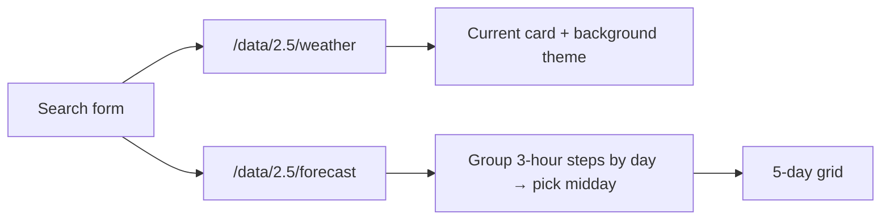

# 🌦️ Weather App

**Search any city for the current weather and a 5-day forecast. The background changes with the conditions, and recent searches are remembered.**


## Features

- **Current conditions:** temperature, feels-like, humidity, wind speed and an icon, with descriptions in Thai
- **5-day forecast:** one reading per day, taken from the 3-hourly forecast at the step closest to midday
- **Dynamic background:** sunny, cloudy, rainy or snowy themes for day and night, plus hot and cold accents
- **Search history:** the last 5 cities, filtered as you type and saved in `localStorage` between visits

## How it works



- City names are URL-encoded before they are sent to the API.
- History items are built with `textContent`, so a saved search can never inject HTML into the page.
- Failed lookups show a friendly error instead of breaking the page.

## Run it

It's a static site with no build step:

```bash
git clone https://github.com/tawan230666/my-weather-app.git
cd my-weather-app
python3 -m http.server 8000   # then open http://localhost:8000
```

> **API key:** the app uses a free-tier OpenWeatherMap key in `js/script.js`. Any key in a front-end-only app is visible to visitors, so for real use you would route requests through a small backend that holds the key. To use your own, [create a free key](https://home.openweathermap.org/api_keys) and replace `apiKey`.
